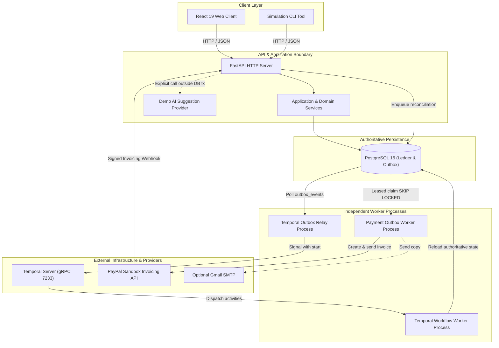
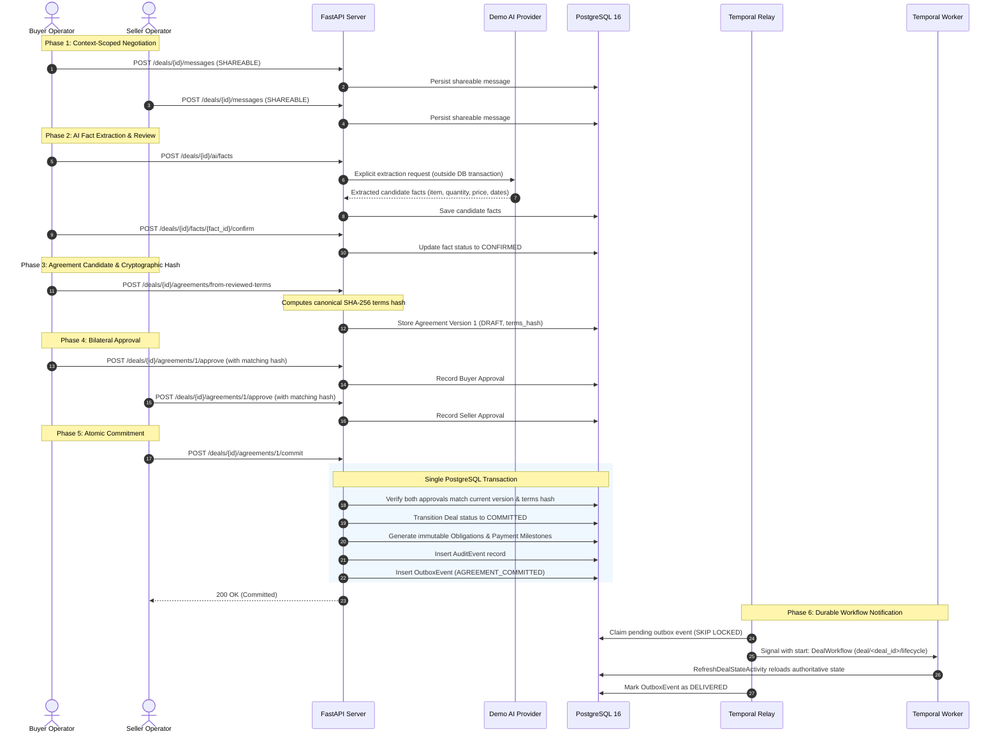
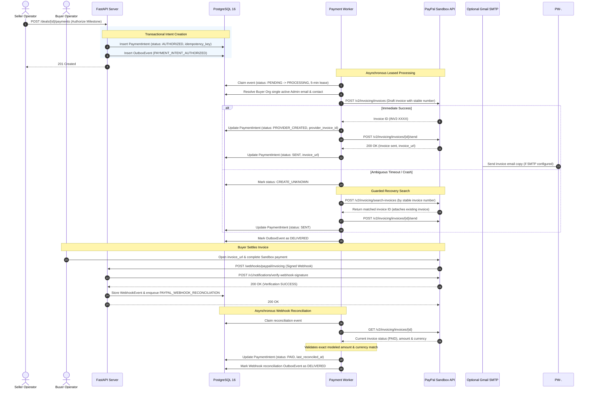

# SyncAlly Architecture

This document describes the architecture, system topology, bilateral consensus lifecycle, and integration patterns of SyncAlly.

---

## 1. System Overview and Ownership Boundaries

SyncAlly is structured as a Python modular monolith with a modern React web client and PostgreSQL as the authoritative commercial ledger. The system isolates HTTP intake, workflow orchestration, database outbox relay, and external payment integration into independent runtime processes sharing domain and application services.

### Process & Package Ownership

| Subsystem / Directory | Process Type | Responsibilities & Architectural Invariants |
| --- | --- | --- |
| `backend/src/syncally/api/` | API Server | Authentication, request validation, actor authorization, OpenAPI schema generation, request correlation tracing via `X-Correlation-ID`. Replaces raw access logs with structured, redacted JSON logging. |
| `backend/src/syncally/domain/` | In-Process Core | Pure commercial business logic: trade terms, bilateral consensus invariants, immutable agreement hashing (`SHA-256`), monetary math (`Money`), and payment state machines. **Strictly zero external dependencies** (no FastAPI, SQLAlchemy, or provider imports). |
| `backend/src/syncally/application/` | In-Process Core | Use cases, repository interfaces (ports), and coordination between domain entities, notification envelopes, and security boundaries. |
| `backend/src/syncally/infrastructure/` | Cross-Process Adapters | SQLAlchemy 2.0 repositories, transactional outbox implementations, PostgreSQL advisory locks for migrations, demo AI provider, PayPal Sandbox client, webhook HMAC verification, and Gmail SMTP notifier. |
| `backend/src/syncally/workflows/` | Temporal Worker | Standalone process (`python -m syncally.workflows.worker`). Hosts `DealWorkflow` and `RefreshDealStateActivity`. Imports no FastAPI routes. Reloads authoritative state from PostgreSQL rather than trusting workflow history. |
| `backend/src/syncally/cli/` | Background Workers & Tools | Contains `outbox_worker.py` (relays DB outbox to Temporal), `payment_worker.py` (processes PayPal invoices), `seed_demo.py` (provisions demo accounts), and `simulate_deal_flow.py` (two-sided automated simulation). |
| `frontend/src/` | Single Page App | Dual-role negotiation view, private/shareable message composer, reactive fact review badges, agreement candidate approvals, payment triggers, and developer role switcher. |

---

## 2. HTTP Route Map

All endpoints are registered through `syncally.api.main:app` and enforce actor authorization and payload limits (maximum request body size: 16 KB).

### Session & Authentication
| Method | Path | Summary & Access Rules |
| --- | --- | --- |
| `POST` | `/auth/login` | Authenticate using email and password; returns access and refresh JWT tokens. |
| `POST` | `/auth/refresh` | Rotate access token using a valid, unrevoked refresh token. |
| `POST` | `/auth/dev-login` | Development/test shortcut for instant authentication using `DEV_AUTH_USER_ID`. |

### Developer & Test Tools
| Method | Path | Summary & Access Rules |
| --- | --- | --- |
| `POST` | `/dev/switch-role` | Switch active session between seeded `BUYER`, `SELLER`, and `ADMIN`. Gated to `APP_ENV=development\|test` and demo administrator session. |
| `POST` | `/dev/reset-demo` | Safely purges deals and activity between demo organizations while preserving accounts and non-demo records. |

### Organizations & Directory
| Method | Path | Summary & Access Rules |
| --- | --- | --- |
| `GET` | `/organizations` | List organizations where the authenticated actor has an active membership. |
| `POST` | `/organizations` | Register a new organization and assign the creator as `ADMIN`. |
| `GET` | `/organizations/directory` | Search active organizations by legal entity name for seamless deal creation. |
| `GET` | `/organizations/{organization_id}` | Fetch public or member details for a specific organization. |

### Membership & Invitations
| Method | Path | Summary & Access Rules |
| --- | --- | --- |
| `POST` | `/organizations/{organization_id}/members` | Add a user directly to an organization (Admin only). |
| `POST` | `/organizations/{organization_id}/invitations` | Issue a signed, single-use email invitation for team onboarding or counterparty partnership. |
| `POST` | `/invitations/accept` | Accept an invitation token; creates user account or binds existing user to organization. |

### Deals & Conversations
| Method | Path | Summary & Access Rules |
| --- | --- | --- |
| `GET` | `/deals` | List all deals where the caller's active organizations participate as buyer or seller. |
| `POST` | `/deals` | Initiate a new trade deal between buyer and seller organizations. |
| `GET` | `/deals/{deal_id}` | Retrieve deal status, participants, and metadata. |
| `GET` | `/deals/{deal_id}/messages` | List authorized messages for the deal. Private messages are filtered to caller's org. |
| `POST` | `/deals/{deal_id}/messages` | Post a message with explicit visibility: `SHAREABLE` (both parties) or `PRIVATE` (caller org only). |
| `GET` | `/deals/{deal_id}/messages/existence` | Verify whether messages exist in the deal without leaking message contents. |

### AI Extraction & Fact Review
| Method | Path | Summary & Access Rules |
| --- | --- | --- |
| `POST` | `/deals/{deal_id}/ai/facts` | Trigger explicit AI extraction of commercial terms from authorized messages. |
| `POST` | `/deals/{deal_id}/ai/proposal` | Generate a candidate agreement proposal using AI from confirmed facts. |
| `GET` | `/deals/{deal_id}/facts` | Retrieve all candidate, confirmed, clarified, and rejected commercial facts for the deal. |
| `POST` | `/deals/{deal_id}/facts` | Manually insert a commercial fact without AI assistance. |
| `PATCH` | `/deals/{deal_id}/facts/{fact_id}` | Update the value or notes of an existing fact. |
| `POST` | `/deals/{deal_id}/facts/{fact_id}/confirm` | Confirm an extracted fact; marks it authoritative and overlays into proposal draft. |
| `POST` | `/deals/{deal_id}/facts/{fact_id}/reject` | Reject an inaccurate fact candidate. |
| `POST` | `/deals/{deal_id}/facts/{fact_id}/clarify` | Flag a fact as needing clarification. |
| `PATCH` | `/deals/{deal_id}/facts/{fact_id}/visibility`| Toggle fact visibility between private and shareable. |

### Agreements & Bilateral Consensus
| Method | Path | Summary & Access Rules |
| --- | --- | --- |
| `GET` | `/deals/{deal_id}/agreements/current` | Get the latest active agreement version, approval states, and terms hash. |
| `POST` | `/deals/{deal_id}/agreements` | Create a new agreement candidate with explicit terms. |
| `POST` | `/deals/{deal_id}/agreements/from-reviewed-terms` | Compile an agreement version directly from confirmed commercial facts. |
| `POST` | `/deals/{deal_id}/agreements/{version_number}/approve` | Register bilateral approval from caller's organization against exact version and terms hash. |
| `POST` | `/deals/{deal_id}/agreements/{version_number}/reject` | Reject an agreement candidate version. |
| `POST` | `/deals/{deal_id}/agreements/{version_number}/commit` | Atomically commit agreement once both buyer and seller have approved matching version and hash. |

### Payments & Milestones
| Method | Path | Summary & Access Rules |
| --- | --- | --- |
| `POST` | `/deals/{deal_id}/payments` | Authorize payment milestone for a committed agreement; enqueues outbox event. |
| `GET` | `/deals/{deal_id}/payments` | Query payment intents, dispatch status, invoice URLs, and reconciliation state. |

### Commercial Documents
| Method | Path | Summary & Access Rules |
| --- | --- | --- |
| `GET` | `/deals/{deal_id}/documents/commercial-draft` | Generate a canonical read-only commercial invoice / sales contract draft from committed terms. |

### Webhooks & Operational Health
| Method | Path | Summary & Access Rules |
| --- | --- | --- |
| `POST` | `/webhooks/paypal/invoicing` | Ingest and verify PayPal Invoicing webhook events using provider cryptographic signatures. |
| `GET` | `/health` | Liveness probe: verifies FastAPI application process responsiveness. |
| `GET` | `/health/database` | Readiness probe: acquires connection and verifies `SELECT 1` against PostgreSQL. |

---

## 3. Bilateral Consensus Lifecycle

Bilateral consensus is the core invariant of SyncAlly: no trade agreement can commit without independent, cryptographic approval of the identical terms by both organizations.

### Consensus Guarantees
1. **Canonical Terms Hash:** Agreement terms are canonically serialized into JSON and hashed with SHA-256. Approvals store this exact digest.
2. **Zero In-Place Mutation:** Any alteration to terms creates a new agreement version (e.g., version 2), which resets all approvals to empty.
3. **Optimistic Locking Guard:** When `commit` is invoked, the database query requires both active buyer and seller approvals for the exact version number and terms hash. If a counterparty revokes or updates terms concurrently, the commit transaction aborts immediately.

---

## 4. PayPal Sandbox Invoicing & Reconciliation Flow

The payment worker operates completely independently from the HTTP API and Temporal workflows. It communicates with PayPal Sandbox via an at-least-once outbox pattern.

### Safety & Ambiguity Handling
- **Idempotency Key & Stable Invoice Number:** Every payment intent generates a deterministic, unique invoice number based on the deal and milestone identifiers.
- **Guard Against Duplicate Invoices:** If a network timeout or process crash occurs during invoice creation, the worker never creates a new invoice blindly. It enters `CREATE_UNKNOWN`, performs a lookup by invoice number in PayPal Sandbox, and reuses the existing record.
- **Strict Verification Before Settlement:** Webhook notifications alone do not mark payments `PAID`. Webhooks enqueue a reconciliation event, prompting the payment worker to query PayPal directly, verify cryptographic event headers, and ensure currency and amounts match before updating ledger state.

---

## 5. Temporal Worker & Outbox Architecture

SyncAlly uses Temporal exclusively for durable, fault-tolerant lifecycle state management, keeping domain persistence and commercial logic inside PostgreSQL.

```mermaid
flowchart LR
    subgraph PostgreSQL["PostgreSQL 16"]
        Deals[(deals table)]
        Outbox[(outbox_events table)]
    end

    subgraph RelayProcess["Temporal Outbox Relay Process"]
        Poller["Outbox Poller (2.0s interval)"]
        Starter["TemporalDealWorkflowStarter"]
    end

    subgraph TemporalCluster["Temporal Cluster"]
        Queue["Task Queue: syncally-deals"]
        Workflow["DealWorkflow (deal/<id>/lifecycle)"]
    end

    subgraph WorkerProcess["Temporal Workflow Worker Process"]
        Executor["Activity Worker"]
        Activity["RefreshDealStateActivity"]
    end

    Deals -.->|Transactionally written with| Outbox
    Outbox -->|Claim PENDING events| Poller
    Poller --> Starter
    Starter -->|signal_with_start| Queue
    Queue --> Workflow
    Workflow -->|Schedule activity| Executor
    Executor --> Activity
    Activity -->|Query current state| Deals
```

### Decoupling Rules & Guarantees
1. **Outbox Pattern:** The FastAPI server never communicates directly with Temporal during an HTTP request. All workflow notifications are transactionally written into `outbox_events` within the same database transaction as the business operation.
2. **Signal With Start:** The outbox relay (`syncally.cli.outbox_worker`) delivers events using `signal_with_start`. This guarantees that `DealWorkflow` is running under the deterministic ID `deal/<deal_id>/lifecycle`.
3. **Authoritative Reloading:** Workflow signals contain no business state; they are purely wake-up notifications. The workflow schedules `RefreshDealStateActivity`, which opens a fresh SQLAlchemy session to PostgreSQL and loads the authoritative state of the deal.
4. **Boundary Isolation:** Temporal workers never call PayPal APIs, never generate commercial documents, and never run FastAPI routes.

---

## 6. Configuration & Environment Variables

SyncAlly loads configuration using Pydantic Settings from `backend/.env`, with operating system environment variables taking precedence.

| Environment Variable | Type | Default | Scope | Description & Constraints |
| --- | --- | --- | --- | --- |
| `APP_ENV` | `string` | `"production"` | Backend | Runtime environment (`production`, `development`, `test`). Fails closed to production if omitted. |
| `DEBUG` | `boolean` | `false` | Backend | Enable debug behavior and verbose diagnostics. |
| `DATABASE_URL` | `string` | *Computed* | Backend | PostgreSQL connection string (`postgresql+psycopg://...`). Required outside dev/test. |
| `JWT_SECRET` | `string` | `""` | Backend | Shared secret for signing auth tokens. Required outside dev/test (minimum 43 URL-safe chars / 32 random bytes). |
| `JWT_ALGORITHM` | `string` | `"HS256"` | Backend | Symmetric HMAC algorithm (`HS256`, `HS384`, `HS512`). |
| `JWT_ISSUER` | `string \| null`| `None` | Backend | Optional JWT `iss` claim verification. |
| `JWT_AUDIENCE` | `string \| null`| `None` | Backend | Optional JWT `aud` claim verification. |
| `ACCESS_TOKEN_TTL_MINUTES` | `int` | `15` | Backend | Lifespan of access tokens in minutes. |
| `REFRESH_TOKEN_TTL_DAYS` | `int` | `30` | Backend | Lifespan of refresh tokens in days. |
| `MAX_ORGANIZATIONS_PER_USER` | `int` | `5` | Backend | Maximum organizations a user can belong to. |
| `DEV_AUTH_USER_ID` | `string \| null`| `None` | Backend | User ID for instant development login; strictly forbidden in production. |
| `TEMPORAL_ADDRESS` | `string` | `"localhost:7233"` | Backend | Host and port for Temporal server gRPC endpoint. |
| `TEMPORAL_NAMESPACE` | `string` | `"default"` | Backend | Temporal namespace for workflows. |
| `TEMPORAL_TASK_QUEUE` | `string` | `"syncally-deals"` | Backend | Task queue shared between relay and worker. |
| `TEMPORAL_TLS` | `boolean` | `false` | Backend | Enforce TLS for Temporal. Required outside dev/test. |
| `OUTBOX_POLL_INTERVAL_SECONDS` | `float` | `2.0` | Backend | Polling frequency for the outbox relay and payment worker. |
| `OUTBOX_BATCH_SIZE` | `int` | `25` | Backend | Maximum outbox rows claimed per iteration. |
| `PAYPAL_CLIENT_ID` | `string` | `""` | Payments | PayPal Sandbox REST application Client ID. |
| `PAYPAL_CLIENT_SECRET` | `SecretStr` | `""` | Payments | PayPal Sandbox REST application Secret. |
| `PAYPAL_WEBHOOK_ID` | `string` | `""` | Payments | PayPal Invoicing webhook subscription ID for signature verification. |
| `GMAIL_SMTP_USERNAME` | `string` | `""` | Payments | Optional Gmail account for invoice copy forwarding. |
| `GMAIL_APP_PASSWORD` | `SecretStr` | `""` | Payments | Optional Google 16-character App Password for SMTP. |
| `GMAIL_FROM_EMAIL` | `string` | `""` | Payments | Optional verified sender alias for Gmail SMTP. |
| `VITE_API_PROXY_TARGET` | `string` | `"http://127.0.0.1:8000"` | Frontend | Dev server proxy target for API requests. |
| `VITE_API_BASE_URL` | `string` | `""` | Frontend | Base URL prefix for frontend API client. |
| `VITE_ENABLE_DEV_SWITCHER` | `string` | `""` | Frontend | Set to `"true"` to expose the Dev Role Switcher outside Vite development builds. |
| `SYNCALLY_API_URL` | `string` | `"http://127.0.0.1:8000"` | Simulation CLI | Target base URL for live simulation CLI runs. |
| `BUYER_PASSWORD` | `string` | `"buyer-password-123"` | Simulation CLI | Password override for buyer demo account during simulation. |
| `SELLER_PASSWORD` | `string` | `"seller-password-456"` | Simulation CLI | Password override for seller demo account during simulation. |

---

## 7. Operational Scope and Production Readiness

### Implemented Capabilities
- **Commercial Ledger:** Full PostgreSQL schema with Alembic migrations, advisory-lock serialization, and strict relationship cascades.
- **Dual-Party Consensus:** Cryptographic verification of SHA-256 agreement terms hashes before commitment.
- **Auditable Logging:** Structured JSON console logging across API and workers. Every HTTP response emits an `X-Correlation-ID` header and logs request duration, status code, and deal ID without echoing sensitive request/response bodies or query strings.
- **Fault-Tolerant Outbox:** Database leasing with exponential backoff and jitter prevents outbox event loss during worker restarts.

### Architectural Deferred Integrations
The following capabilities represent intentional future milestones rather than missing dependencies in the current vertical slice:
1. **S3 Object Storage:** Commercial document generation currently outputs structured JSON and HTML drafts directly. Blob persistence in AWS S3 or MinIO is deferred.
2. **LangGraph Dynamic Agent Workflows:** Fact extraction and proposal drafting currently use explicit, bounded demo AI adapters with strict schema validation. Stateful multi-agent graph orchestration is deferred.
3. **OpenTelemetry Tracing:** Request correlation is currently managed via `X-Correlation-ID` and structured JSON logs. Distributed OTel exporters remain a deployment-stage addition.
4. **Live PayPal Production Onboarding:** The payment adapter is locked to `https://api-m.sandbox.paypal.com`. Transition to production requires PayPal partner vetting, live merchant onboarding, and enterprise webhook forwarding infrastructure.
