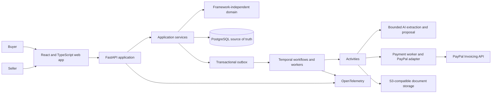
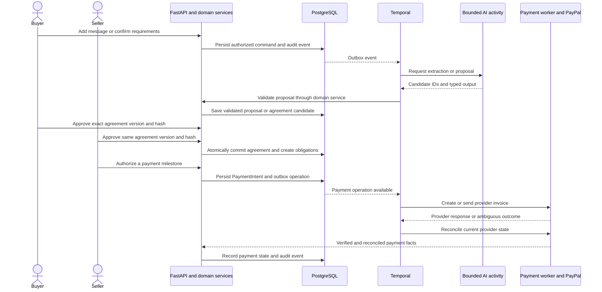

# SyncAlly Architecture

**Status:** Proposed system architecture; commercial domain foundation implemented
**Source:** Adapted from the architecture documents supplied for the project on 2026-10-13.

This document summarizes the intended system shape. Detailed contracts and the original decision record are in [`docs/architecture/`](docs/architecture/README.md). Nothing here implies that the design has been implemented or deployed.

The current domain code covers deal and negotiation foundations, canonical trade terms, bilateral agreement approval, and payment-intent state. The API, persistence, authorization handlers, outbox, Temporal workers, and provider adapters remain unimplemented. See [the domain layer implementation boundary](docs/architecture/05-domain-layer.md).

## System shape

The first implementation is planned as a modular monolith. The web client calls a FastAPI application; domain and application services own business rules; PostgreSQL stores authoritative state. Temporal workers coordinate waits, timers, and retries for long-running deals. Bounded AI work may run inside activities, while a payment worker integrates with PayPal through an adapter.

## Ownership boundaries

| Component | Owns | Does not own |
| --- | --- | --- |
| Domain and application services | Authorization checks, deal and agreement transitions, canonical terms, approvals, obligations, payment intents, audit records | HTTP, Temporal internals, LLM reasoning, PayPal-specific behavior |
| FastAPI | HTTP request/response handling and authenticated API boundary | Commercial policy or trusted client-supplied roles |
| PostgreSQL | Durable commercial records, constraints, transactions, outbox | Workflow execution history or provider-side payment truth |
| Temporal | Durable process progression, waits, timers, retries, recovery | Approval authority, commercial ledger, direct business-state writes |
| AI activities | Typed candidate extraction and proposal generation using authorized context | Approvals, commitments, payment authorization, unrestricted provider calls |
| PayPal adapter and reconciliation worker | Provider requests, normalized responses, webhook verification, provider-state reconciliation | Deciding whether a commercial obligation was authorized |

The domain layer should not import FastAPI, Temporal, LangGraph, or PayPal-specific code. Adapters translate external inputs and outputs into domain-owned contracts.

## Deal and payment flow

Provider calls happen outside database transactions. When an outcome is ambiguous, persist an unknown/pending state and reconcile before retrying. Webhooks are verified and deduplicated, then used to trigger reconciliation; a webhook or browser redirect alone does not prove payment.

## Commercial invariants

- Buyer and seller are distinct organizations, and every read or write is authorized against deal participation.
- Extracted constraints remain unconfirmed until reviewed under an explicit policy; private context never leaks into shared proposals or traces.
- Proposals are non-binding. A committed agreement is an immutable, canonical version.
- Agreement commitment is one database transaction that checks authorized approvals from both organizations for the same current version and terms hash.
- Payment amounts use fixed-precision decimal values and explicit currencies.
- A payment intent is durably authorized before any provider-side effect. A payment becomes `PAID` only after reconciliation confirms the full modeled amount.
- External side effects use stable operation IDs, bounded retries, and reconciliation. The design targets safe at-least-once processing rather than claiming cross-system exactly-once execution.
- Deal, payment, and fulfillment lifecycles remain separate state machines.

## Workflow rules

Use one lifecycle workflow per persisted deal, with a stable workflow ID. Workflow code orchestrates; activities and application services perform external calls and validated state changes. Workflow arguments and history should contain stable record IDs and minimal non-sensitive context, not private negotiation details or credentials. Signals notify the workflow but do not grant authority; referenced domain records must be loaded and validated.

Every wait needs a deadline and escalation policy. A timeout never implies acceptance or payment. Retries are bounded, and permanent authorization or validation failures are not blindly retried.

## Initial deployment direction

The proposed local development environment uses Docker Compose. For production, the design favors managed PostgreSQL and Temporal where practical, with the API and Temporal workers running as separate processes from the same repository. Only the API shell exists so far; the Temporal worker and local infrastructure definitions remain future work.

## Scope and open gates

The initial vertical slice is intentionally constrained: one buyer, one seller, one supported trade/currency scenario, bilateral approval, draft commercial documents, and PayPal Sandbox. Before production, SyncAlly needs tenant-isolation and security review, operational recovery and monitoring, supported-market/legal review, and confirmation of PayPal merchant eligibility and permissions. See the [architecture decision record](docs/architecture/04-architecture-decision-record.md) for rollout gates and alternatives.
