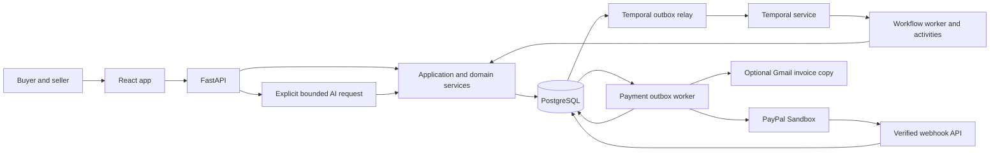
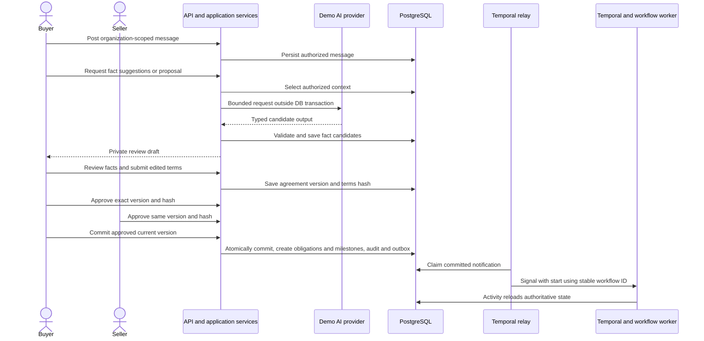
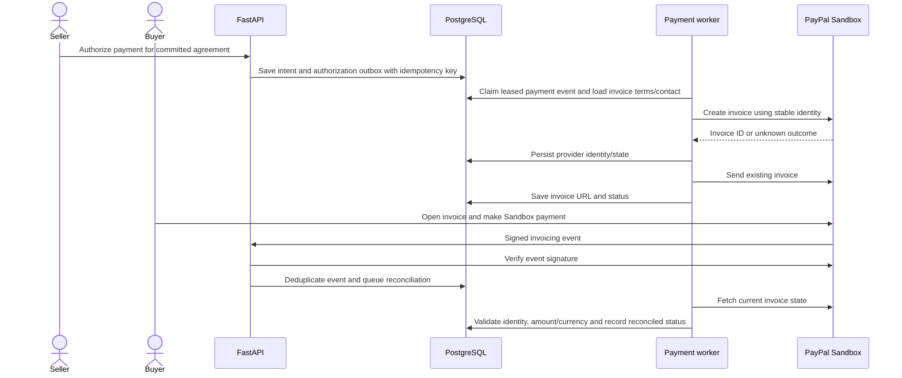

# SyncAlly architecture

This overview describes the implemented local/demo vertical slice. The [architecture records](docs/architecture/README.md) retain deeper contracts and design history; proposals in those records should be checked against current source. See [README](README.md#local-quickstart) for startup and [operations](docs/operations.md) for recovery.

## System and ownership

SyncAlly is a Python modular monolith with a React/TypeScript web client and PostgreSQL as its commercial ledger. Four backend processes share application/domain services: HTTP API, Temporal workflow worker, Temporal outbox relay, and payment worker. The frontend is a fifth process in local development.

| Boundary | Owns |
| --- | --- |
| `api/` | Authentication, request validation, authorized HTTP commands/reads and response shaping |
| `domain/` | Canonical trade terms, state transitions, immutable commitment, money and payment rules; no FastAPI/Temporal/provider dependencies |
| `application/` | Use cases and ports; domain validation and orchestration |
| `infrastructure/` | SQLAlchemy records/repositories, transactions, outbox delivery, demo AI, Sandbox adapter, webhook verification and optional Gmail |
| `workflows/` | Durable lifecycle orchestration and activities that reload authoritative state |
| `cli/` | Worker entrypoints, demo seeding and lifecycle simulation |
| Frontend | Organization-scoped review buffers, synchronized saved facts and proposal previews, human approval/payment actions |

AI extraction/drafting is explicitly requested through the API. Authorized context is selected before the provider call, which runs outside the database transaction; returned suggestions are validated before persistence. It is not a Temporal-triggered AI loop. The demo provider is not an installed LangGraph workflow.

## HTTP route map

These routes are registered by [api/main.py](backend/src/syncally/api/main.py). `/docs` and `/openapi.json` provide generated schemas, including payloads and query parameters. Braces below denote path parameters; all deal operations apply actor/deal authorization. Scoped message/fact/AI requests also require an organization context the actor may use.

| Area | Method and path |
| --- | --- |
| Session | `POST /auth/login`, `POST /auth/refresh`, `POST /auth/dev-login` |
| Development | `POST /dev/switch-role`, `POST /dev/reset-demo` |
| Organizations | `GET /organizations`, `POST /organizations`, `GET /organizations/directory`, `GET /organizations/{organization_id}` |
| Membership and invitations | `POST /organizations/{organization_id}/members`, `POST /organizations/{organization_id}/invitations`, `POST /invitations/accept` |
| Deals | `GET /deals`, `POST /deals`, `GET /deals/{deal_id}` |
| Messages | `GET /deals/{deal_id}/messages`, `POST /deals/{deal_id}/messages`, `GET /deals/{deal_id}/messages/existence` |
| AI requests | `POST /deals/{deal_id}/ai/facts`, `POST /deals/{deal_id}/ai/proposal` |
| Fact entry/correction | `GET /deals/{deal_id}/facts`, `POST /deals/{deal_id}/facts`, `PATCH /deals/{deal_id}/facts/{fact_id}` |
| Fact review | `POST /deals/{deal_id}/facts/{fact_id}/confirm`, `POST /deals/{deal_id}/facts/{fact_id}/reject`, `POST /deals/{deal_id}/facts/{fact_id}/clarify`, `PATCH /deals/{deal_id}/facts/{fact_id}/visibility` |
| Agreement candidates | `GET /deals/{deal_id}/agreements/current`, `POST /deals/{deal_id}/agreements`, `POST /deals/{deal_id}/agreements/from-reviewed-terms` |
| Bilateral decisions | `POST /deals/{deal_id}/agreements/{version_number}/approve`, `POST /deals/{deal_id}/agreements/{version_number}/reject`, `POST /deals/{deal_id}/agreements/{version_number}/commit` |
| Payment | `POST /deals/{deal_id}/payments`, `GET /deals/{deal_id}/payments` |
| Document draft | `GET /deals/{deal_id}/documents/commercial-draft` |
| Provider intake | `POST /webhooks/paypal/invoicing` |
| Health | `GET /health`, `GET /health/database` |

Session routes issue/rotate JWT credentials; active user and database membership determine authority, not a role sent by the browser. Development shortcuts are environment-gated. Invitations are signed, expire, and are single-use; acceptance can create an account, add a team member or onboard a separate counterparty organization for a deal. There is no independent `/auth/register` route. The message-existence endpoint exposes only presence, not another organization's private message content.

## Review and bilateral consensus

Commitment is an explicit command after bilateral approval. The UI can issue that command once approvals satisfy the policy; approval itself is not a provider side effect. A stale version/hash or missing authorized approval cannot commit. Editing terms produces a new version requiring matching approvals. Either authorized party may request commit; the database transaction remains the final guard.

The parent conversation component owns saved fact state. Suggestion cards reconcile against saved versions while retaining applicable unsaved edits. Newly confirmed fields overlay an existing proposal without discarding unrelated human edits. A lost authorized fact or conflicting confirmed values invalidates affected draft fields and blocks sending until review/refresh. In-flight responses retain fact provenance and cannot silently restore revoked confirmed terms.

## Payment intent and Sandbox invoice flow

The payment worker independently consumes payment authorization and webhook-reconciliation events; Temporal does not call it. Provider calls occur outside database transactions. Worker leases, stable request identities and bounded retry policies support safe at-least-once delivery. An ambiguous create/send outcome is reconciled before another effect; it does not authorize a new invoice.

The recipient is resolved from the buyer organization's single active administrator. The browser's recipient confirmation is a human check, not a trusted override. `PAID` requires reconciliation of the full modeled amount/currency; a webhook body, URL, redirect, partial payment or delivered outbox event is insufficient evidence. Optional Gmail delivery is a separate copy of the existing Sandbox invoice.

## Configuration and process contracts

[Settings](backend/src/syncally/config.py) load `backend/.env` relative to the package, with process environment overrides. The [example](backend/.env.example) matches [local Compose](infra/compose.yaml).

| Configuration | Purpose |
| --- | --- |
| `APP_ENV`, `DEBUG`, `DATABASE_URL` | Environment mode, debug behavior and authoritative database connection |
| `JWT_SECRET`, `JWT_ALGORITHM`, `JWT_ISSUER`, `JWT_AUDIENCE`, `ACCESS_TOKEN_TTL_MINUTES`, `REFRESH_TOKEN_TTL_DAYS` | JWT credentials/validation and rotation lifetimes |
| `MAX_ORGANIZATIONS_PER_USER`, `DEV_AUTH_USER_ID` | Organization limit and development/test-only authentication override |
| `TEMPORAL_ADDRESS`, `TEMPORAL_NAMESPACE`, `TEMPORAL_TASK_QUEUE`, `TEMPORAL_TLS` | Relay/worker connection and shared queue |
| `OUTBOX_POLL_INTERVAL_SECONDS`, `OUTBOX_BATCH_SIZE` | Outbox polling cadence and batch size |
| `PAYPAL_CLIENT_ID`, `PAYPAL_CLIENT_SECRET`, `PAYPAL_WEBHOOK_ID` | Sandbox processing and webhook signature verification |
| `GMAIL_SMTP_USERNAME`, `GMAIL_APP_PASSWORD`, `GMAIL_FROM_EMAIL` | Optional invoice email copy |
| `VITE_API_PROXY_TARGET`, `VITE_API_BASE_URL`, `VITE_ENABLE_DEV_SWITCHER` | Frontend API routing and development UI visibility |

Outside development/test, configuration requires an explicit database URL, a cryptographically generated JWT secret containing at least 32 random bytes (43 URL-safe characters minimum), and Temporal TLS. `APP_ENV` defaults to production when omitted. Never expose backend credentials using a `VITE_` variable; those values are browser-visible.

## Scope and deployment

The local Compose file implements persistent PostgreSQL and a Temporal development server; its embedded Temporal history store is separate from the business database. API and workers run as independent host processes. The [restart smoke test](infra/README.md#restart-smoke-test) exercises durable workflow recovery using an isolated schema.

Commercial document generation currently returns a read-only draft from committed terms. S3 object storage, LangGraph orchestration and OpenTelemetry remain deferred design directions. Structured, redacted application logs and correlation IDs are implemented; see [operations](docs/operations.md).

Production requires tenant/security review, deployment monitoring and recovery verification, market/legal review, and provider merchant eligibility/permissions. The isolated simulation is useful lifecycle evidence, not complete-stack startup or a live PayPal delivery gate. See [the ADR](docs/architecture/04-architecture-decision-record.md) for broader rollout decisions.
