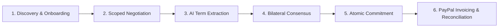

# SyncAlly

SyncAlly is a collaborative B2B trade management platform that turns unstructured commercial negotiations into legally vetted terms, a bilaterally approved agreement, automated commercial document drafts, and verified PayPal Sandbox invoice payments.

The current implementation provides a complete, working vertical slice:
- Organization directory discovery, team management, and secure email invitations.
- Structured bilateral negotiation with organization-scoped private and shareable messaging.
- Human-in-the-loop AI term extraction and reactive proposal synchronization.
- Cryptographic bilateral agreement consensus (version and terms hash verification).
- Atomic agreement commitment generating enforceable obligations and payment milestones.
- Asynchronous PayPal Sandbox invoice generation, dispatch, and webhook-driven reconciliation.
- Developer tooling including an instant Dev Role Switcher and an automated dual-role simulation CLI.

AI suggestions are advisory and non-binding: human operators review and confirm all terms, both organizations must approve the identical agreement version and SHA-256 terms hash, and the seller explicitly requests payment. Production rollout remains subject to the [architecture gates](ARCHITECTURE.md#operational-scope-and-production-readiness).

---

## Core Trade Lifecycle



1. **Discovery & Onboarding:** Authenticate using seeded demo credentials or accept an email invitation. Organizations discover counterparties directly through the searchable legal entity directory (`GET /organizations/directory`) or issue an onboarding invitation. Counterparty identities bind automatically without manual UUID copy-pasting.
2. **Scoped Negotiation:** Buyers and sellers exchange messages in a unified deal timeline. Each message is explicitly tagged as **shareable** (visible to both parties) or **private** (strictly restricted to the authoring organization).
3. **AI Term Extraction & Fact Review:** Operators request on-demand AI suggestions from unstructured messages. Extracted commercial facts (item description, quantity, price, delivery destination, delivery date) are reviewed, confirmed, clarified, or rejected. Confirmed facts synchronize reactively with agreement proposal fields while preserving manual adjustments.
4. **Bilateral Agreement Consensus:** Either party generates a formal agreement candidate. Both buyer and seller independently approve the exact agreement version number and cryptographic terms hash (`SHA-256`). Any subsequent edits produce a new version, automatically invalidating previous approvals.
5. **Atomic Commitment:** Once bilateral consensus is satisfied, either authorized organization triggers commitment. A single PostgreSQL transaction transitions the deal to `COMMITTED`, generates immutable commercial obligations and payment milestones, writes audit log entries, and enqueues outbox events.
6. **PayPal Invoicing & Reconciliation:** The seller reviews buyer administrator contact details and chooses **Request Payment**. An independent payment worker claims the outbox event, creates and sends a real PayPal Sandbox invoice, and notifies the buyer. When the buyer settles the invoice, verified PayPal webhooks trigger automated payment reconciliation to mark the milestone `PAID`.

> **Project status:** The foundation includes a FastAPI API with health checks, JWT authentication and refresh rotation, protected deal reads, PostgreSQL persistence and migrations, framework-independent domain foundations, and a React/TypeScript frontend shell. Local demo accounts can be provisioned with a development/test-only seed command. F4 adds recipient-bound team/counterparty invitations, invitation signup, private pending deals, and atomic acceptance; unrestricted public self-registration remains disabled. Deal creation, the create/detail browser flow, bilateral agreement approval, and the durable Temporal deal workflow with its separate worker process are implemented. Local PostgreSQL and Temporal development services and an opt-in worker restart smoke test are provided in `infra/`; external payment integration remains planned.
---

## Architecture Overview

SyncAlly is implemented as a Python modular monolith with a modern React web client and PostgreSQL as the single source of truth for commercial state.

| Layer / Component | Technology Stack | Responsibility |
| --- | --- | --- |
| **Frontend Web Client** | React 19, TypeScript, Vite, Tailwind-compatible modern CSS | Dual-role negotiation UI, fact review buffer, live proposal preview, Dev Role Switcher |
| **API Server** | FastAPI, Python 3.12+, Uvicorn, Pydantic v2 | REST API, JWT auth, permission checks, structured logging with `X-Correlation-ID` |
| **Commercial Ledger** | PostgreSQL 16, SQLAlchemy 2, Alembic | Authoritative commercial state, transactional outbox tables, advisory locks |
| **Durable Workflows** | Temporal Server, Temporal Python SDK | Long-running deal lifecycle state orchestration (`deal/<deal_id>/lifecycle`) |
| **Temporal Outbox Relay** | Python background worker (`cli/outbox_worker.py`) | Transactional outbox poller forwarding committed events to Temporal |
| **Payment Outbox Worker** | Python background worker (`cli/payment_worker.py`) | Leased PayPal Sandbox invoice creation, dispatch, and webhook reconciliation |
| **AI Suggestion Engine** | Python bounded provider (`infrastructure/ai/`) | Explicit, non-transactional extraction of commercial facts and proposal drafts |

```
SyncAlly/
├── backend/
│   ├── alembic/                 # Database migrations (PostgreSQL)
│   └── src/syncally/
│       ├── api/                 # FastAPI routes (auth, deals, agreements, dev, webhooks)
│       ├── application/         # Use cases, ports, and business orchestration
│       ├── domain/              # Pure commercial domain models, money, and state machines
│       ├── infrastructure/      # SQLAlchemy repos, outbox, PayPal adapter, demo AI
│       ├── workflows/           # Temporal DealWorkflow and refresh activities
│       └── cli/                 # Worker entrypoints, demo seeder, simulation CLI
├── frontend/
│   ├── src/                     # React 19 client (deals, auth, organizations, UI components)
│   └── vite.config.ts           # Vite bundler, proxy configuration, and Vitest setup
├── infra/
│   └── compose.yaml             # Local Docker Compose services (PostgreSQL 16, Temporal)
└── docs/                        # Architecture decision records and operations runbooks
```

---

## Local Quickstart

Follow these instructions to run the complete SyncAlly application from scratch in **under 5 minutes**.

### Prerequisites

Ensure the following tools are installed on your workstation:
- **Python 3.12+**
- **Node.js 22.13+** (or Node 24+) with `npm`
- **Docker** with **Docker Compose v2** (Docker engine must be running)

---

### Step 1: Environment & Virtual Environment Setup

From the repository root, create a Python virtual environment, install backend dependencies, and copy the example environment configuration:

<!-- slide -->
**POSIX (Linux / macOS / WSL):**
```bash
python3 -m venv .venv
source .venv/bin/activate
pip install -e "./backend[dev]"
test -f backend/.env || cp backend/.env.example backend/.env
```

**Windows (PowerShell):**
```powershell
python -m venv .venv
.\.venv\Scripts\Activate.ps1
pip install -e "./backend[dev]"
if (!(Test-Path backend/.env)) { Copy-Item backend/.env.example backend/.env }
```

The default `backend/.env` is preconfigured for local development (`APP_ENV=development`, local JWT secret, PostgreSQL at `localhost:5432`, and Temporal at `localhost:7233`).

---

### Step 2: Start Infrastructure Services

Launch PostgreSQL and Temporal using Docker Compose from the project root:

```bash
docker compose -f infra/compose.yaml up -d
```

Verify that both containers are healthy:
```bash
docker compose -f infra/compose.yaml ps
docker compose -f infra/compose.yaml exec -T postgres pg_isready -U syncally -d syncally
```

- **PostgreSQL 16** listens on `127.0.0.1:5432`.
- **Temporal Server** listens on `127.0.0.1:7233` (gRPC).
- **Temporal Web UI** is accessible at [http://localhost:8233](http://localhost:8233).

---

### Step 3: Run Database Migrations & Seed Demo Accounts

From an activated terminal, navigate to `backend/`, apply Alembic migrations, and seed the demo buyer and seller accounts:

```bash
cd backend
alembic upgrade head
python -m syncally.cli.seed_demo
```

When prompted, set and confirm a password (between 12 and 128 characters, e.g., `DemoPassword123!`).

The seeder creates two pre-configured administrator accounts:
- **Buyer:** `buyer@syncally.demo` representing **Demo Buyer Co**
- **Seller:** `seller@syncally.demo` representing **Demo Seller Co**

The command asks for each password without displaying it. Use `buyer@syncally.demo` or
`seller@syncally.demo` to sign in. It is disabled outside development/test; public
self-registration is disabled. Recipient-bound invitation signup/acceptance is supported;
matching a signup email is not verified mailbox ownership. See the
[F4 walkthrough and migration safeguards](docs/operations.md#f4-counterparty-onboarding).
> [!NOTE]
> `seed_demo` is idempotent and safe to re-run. If an account already has a password set, it preserves the existing password.

---

### Step 4: Run Backend Processes

SyncAlly separates HTTP handling, durable workflows, outbox delivery, and payment processing into dedicated host processes. Open separate terminal windows for the required processes. In each terminal, activate `.venv` and navigate to `backend/`.

| Terminal | Process | Command | Description |
| --- | --- | --- | --- |
| **1** | **HTTP API** | `python -m uvicorn syncally.api.main:app --reload --port 8000` | REST API with OpenAPI docs at [http://localhost:8000/docs](http://localhost:8000/docs) |
| **2** | **Workflow Worker** | `python -m syncally.workflows.worker` | Executes durable Temporal `DealWorkflow` activities |
| **3** | **Temporal Relay** | `python -m syncally.cli.outbox_worker` | Relays committed outbox events to Temporal |
| **4** | **Payment Worker** | `python -m syncally.cli.payment_worker` | Processes PayPal Sandbox invoice dispatch & reconciliation *(optional for core negotiation)* |

> [!TIP]
> For core conversation, term extraction, agreement consensus, and commitment testing, running **Terminals 1, 2, and 3** is sufficient. The payment worker requires PayPal Sandbox credentials (see below) and is only needed when testing real invoice dispatch.

Verify API server and database health:
```bash
curl http://localhost:8000/health
curl http://localhost:8000/health/database
```
Both return `{"status":"ok"}`.

---

### Step 5: Run the Frontend

Open a new terminal window from the repository root:

```bash
cd frontend
npm ci
npm run dev
```

Open the printed URL (typically [http://localhost:5173](http://localhost:5173)) in your browser.

- Sign in with `buyer@syncally.demo` or `seller@syncally.demo` using the password configured in Step 3.
- The Vite dev server automatically proxies API requests (`/auth`, `/dev`, `/organizations`, `/deals`) to `http://127.0.0.1:8000`.

---

## Developer Role Switcher & Simulation CLI

### Dev Role Switcher

When running in development mode (or with `VITE_ENABLE_DEV_SWITCHER=true`), a floating **Dev Role Switcher** widget appears in the lower-right corner of the web interface.

- **Instant Role Toggle:** Switch between **Buyer** (`buyer@syncally.demo`) and **Seller** (`seller@syncally.demo`) with one click without manually logging out or entering credentials.
- **Admin Target:** The neutral **Admin** role deterministically resolves to the seeded buyer administrator.
- **Reset Demo Data:** Click **Reset Demo Data** to safely purge test deals and related milestones between the two demo organizations while preserving user accounts and non-demo organizational data.
- **Environment Guard:** Dev endpoints (`POST /dev/switch-role`, `POST /dev/reset-demo`) fail closed (HTTP 403) unless `APP_ENV` is set to `development` or `test` and the caller holds an authenticated demo admin token.

---

### Automated Simulation CLI

SyncAlly includes an automated dual-role simulation CLI (`simulate_deal_flow.py`) that executes the entire end-to-end commercial lifecycle in seconds.

#### Fast In-Process / CI Mode
To verify the full 7-step lifecycle without starting PostgreSQL, Temporal, or the browser:

```bash
python -m syncally.cli.simulate_deal_flow --ci --no-color
```

This executes in **under 500 milliseconds** against an in-memory SQLite/FastAPI test harness.

#### Live Network Mode
To run the automated simulation against your running local backend API and PostgreSQL database:

```bash
BUYER_PASSWORD="DemoPassword123!" SELLER_PASSWORD="DemoPassword123!" \
python -m syncally.cli.simulate_deal_flow --base-url http://127.0.0.1:8000 --no-color
```

*(On Windows PowerShell, set `$env:BUYER_PASSWORD="DemoPassword123!"` and `$env:SELLER_PASSWORD="DemoPassword123!"` before running).*

The simulation exercises all 7 checkpoints:
1. `[1/7]` Authenticates as Buyer and Seller via JWT credentials.
2. `[2/7]` Discovers counterparty in directory and creates draft deal.
3. `[3/7]` Posts proposal message into deal conversation.
4. `[4/7]` Requests AI fact suggestions and confirms commercial terms.
5. `[5/7]` Drafts agreement proposal and registers bilateral approvals.
6. `[6/7]` Commits agreement atomically and verifies `COMMITTED` status.
7. `[7/7]` Authorizes payment milestone and prints invoice URL.

---

## Real PayPal Sandbox Invoices

To dispatch real PayPal Sandbox invoices and reconcile payments:

1. Obtain a Sandbox REST app `Client ID` and `Secret` from the [PayPal Developer Dashboard](https://developer.paypal.com/).
2. In `backend/.env`, configure:
   ```env
   PAYPAL_CLIENT_ID=your-sandbox-client-id
   PAYPAL_CLIENT_SECRET=your-sandbox-client-secret
   PAYPAL_WEBHOOK_ID=your-sandbox-webhook-id
   ```
3. Start or restart the payment worker:
   ```bash
   python -m syncally.cli.payment_worker
   ```
4. **Invoice Contact Resolution:** The invoice recipient is derived automatically from the buyer organization's single active administrator.
5. **Webhook Forwarding:** To test live webhook callbacks on localhost, forward PayPal invoicing webhooks to your local API endpoint:
   `POST http://localhost:8000/webhooks/paypal/invoicing`
6. **Optional Gmail Copy:** To dispatch an email copy of the Sandbox invoice, configure `GMAIL_SMTP_USERNAME`, `GMAIL_APP_PASSWORD` (Google 16-character App Password), and optional `GMAIL_FROM_EMAIL` in `backend/.env`.

See [Safe Operations & Recovery](docs/operations.md) for detailed handling of webhook reconciliation, ambiguous provider outcomes, and operator runbooks.

---

## Quality & Verification Commands

### Backend Verification
From an activated terminal in `backend/`:

```bash
# Run complete unit test suite (520+ tests)
python -m unittest discover -s tests -v

# Run Ruff code style and static analysis check
python -m ruff check src tests
```

### Frontend Verification
From `frontend/`:

```bash
# Run Vitest test suite (210+ component & unit tests)
npm test

# Run ESLint and TypeScript compilation check
npm run lint:check

# Verify production bundle build
npm run build
```

---

## License

[MIT](LICENSE)
