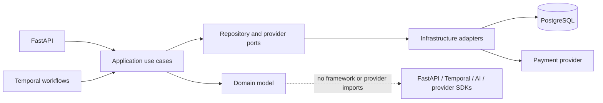
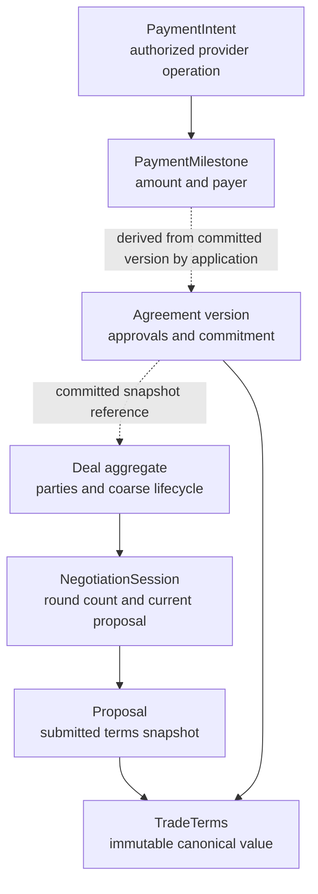

# Domain Layer

**Status:** Implemented foundation; persistence and application workflows remain proposed
**Scope:** Framework-independent commercial models in `backend/src/syncally/domain`

This document distinguishes code that exists from the larger architecture in the reference design. The current slice implements shared money and identifiers, deal lifecycle, negotiation proposals, canonical trade terms, bilateral agreement approval, and payment-intent state. It does not implement repositories, database transactions, organization membership/authorization, outbox delivery, execution plans, documents, or provider adapters.

## Dependency direction



The domain owns deterministic commercial invariants. Application handlers will load aggregates, enforce authenticated actor permissions, coordinate transactions, persist changes and outbox records, and map domain errors to API responses. Adapters perform database and provider operations. A provider response or workflow signal does not directly commit an agreement.

## Implemented model map



The diagram shows references and business flow, not object ownership. These are separate consistency boundaries; a `Deal` does not own every negotiation, agreement, or payment record.

## Invariants in code

| Model | Enforced by domain code |
| --- | --- |
| `Money` | Decimal-only finite amount, normalized three-letter currency, same-currency addition |
| `TradeTerms` | Distinct buyer and seller; non-empty items, shipments, and payment terms; one currency; payment schedule equals line-item total; deterministic JSON and SHA-256 terms hash |
| `Proposal` | Submitted proposal has a single lifecycle path; negotiation checks deal and predecessor references and maximum rounds |
| `Deal` | Buyer differs from seller; explicit transitions and current agreement version check |
| `Agreement` | Only parties approve; approval hash must match immutable terms; commitment requires approval from both parties for that hash |
| `PaymentMilestone` | Positive amount and sequence; explicit payer and payment trigger |
| `PaymentIntent` | Stable idempotency key; payer matches milestone; an ambiguous create cannot retry until reconciled; only reconciled full amount becomes `PAID` |

The application layer must still verify that `authorized_by` is an active member with the required permission. Domain checks cannot establish identity or tenant membership by themselves.

## Key flows

### Agreement commitment

1. Application code creates a new agreement version from validated `TradeTerms`.
2. Each party submits an approval tied to that exact terms hash.
3. Application code verifies identity, membership, permissions, expected deal/version, and concurrency under a transaction.
4. `Agreement.commit()` checks both party approvals and the expected hash.
5. In that same transaction, application code updates the deal, creates obligations/milestones, records audit facts, and writes an outbox event.
6. A dispatcher delivers the event to Temporal after commit.

`Agreement.commit()` enforces the aggregate-level rule. It cannot by itself provide transaction isolation or prevent two database workers from racing; repository locking/version checks and database constraints are still required.

### Payment request and reconciliation

1. An authorized application command creates a durable intent for a milestone with a stable idempotency key.
2. `begin_create()` moves it to `CREATE_PENDING` before the adapter calls the provider.
3. Definite provider creation is recorded; an ambiguous result becomes `CREATE_UNKNOWN`.
4. The intent cannot start another create while the outcome is unknown. The adapter must first reconcile provider state.
5. Only reconciliation can record paid value, and `PAID` requires the complete milestone amount.

The model does not claim exactly-once provider execution. Unique idempotency keys, transaction boundaries, webhook verification, provider lookup, and durable retries belong to the application and infrastructure implementation.

## Package layout

```text
backend/src/syncally/domain/
├── shared/          # IDs, Money, domain errors
├── deals/           # Deal state machine
├── negotiation/     # Proposals and negotiation session
├── agreements/      # TradeTerms, approvals, commitment
└── payments/        # Payment milestone and intent lifecycle
```

Keep framework imports, persistence mappings, external SDKs, actor authentication, and transaction orchestration outside this package. Each bounded context may stay in the same Python process and database while retaining its own invariants.

## Deliberate next steps

The current code is a domain foundation, not an end-to-end vertical slice. Before claiming production behavior, add focused domain tests, then implement application ports and transaction handlers. Remaining domain work includes organization membership and constraints, execution obligations and amendment history, document snapshots, and richer currency/quantity/tax/trade-term policies. Persistence work must add optimistic concurrency, uniqueness for idempotency keys and commitments, transactional outbox records, and migrations. Provider integration must verify callbacks and reconcile outcomes before treating payments as complete.

The initial `TradeTerms` schema supports one currency and requires payment terms to sum to the line-item total. Taxes, discounts, fees, exchange rates, multi-currency deals, per-item shipment allocation, and Incoterms validation are intentionally not inferred or implemented here.
