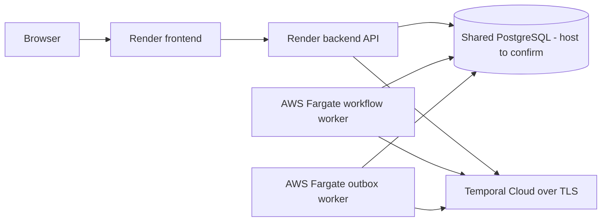
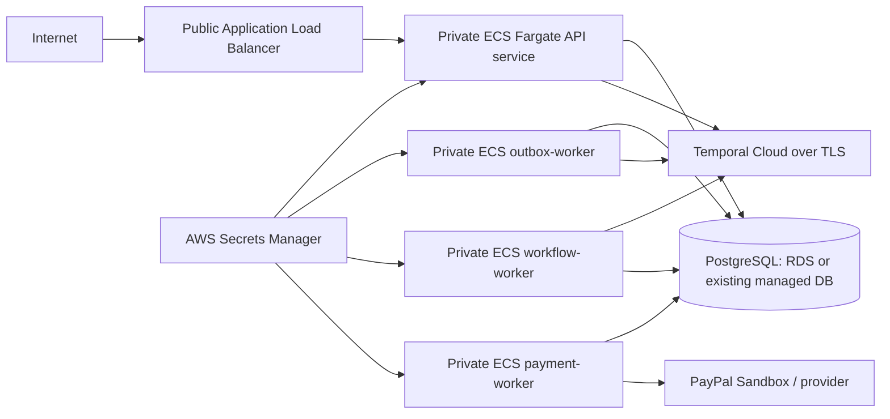

# Deploying SyncAlly's Temporal workers on AWS

**Status:** Temporal Cloud is configured and the backend image is in ECR. Both CloudFormation templates pass AWS template validation; the sandbox database change set is prepared but has not been executed.  
**Scope:** Temporal service connectivity and SyncAlly's workflow, outbox, and payment workers. The frontend and backend API are already hosted on Render. The API's PostgreSQL host still needs to be confirmed before deploying AWS workers.

## Recommendation

For the first AWS deployment, run the SyncAlly processes as Amazon ECS services on AWS Fargate and use Temporal Cloud for the Temporal service. This keeps the application containers inside your AWS account while Temporal operates the workflow service. Temporal describes these as separate deployment choices: application code and workers run on your infrastructure, while the Temporal service can be Temporal Cloud or self-hosted ([Temporal production deployments](https://docs.temporal.io/production-deployment)).

Self-hosting Temporal on AWS is possible, but should be treated as a separate platform project. The Temporal service needs persistent storage, multi-service availability, upgrades, monitoring, backups, and tested recovery. Temporal's production checklist calls out the need to maintain the hosting infrastructure and persistence layer, and warns that production-scale Temporal operations require specialized experience ([production readiness checklist](https://docs.temporal.io/self-hosted-guide/production-checklist)). For a small team, use Temporal Cloud unless owning that operational work is an explicit requirement.

## What this repo runs

The existing deployment already splits the processes into containers in [`infra/deploy/compose.yaml`](../infra/deploy/compose.yaml):

| ECS service | Container command | Purpose |
|---|---|---|
| `workflow-worker` | `python -m syncally.workflows.worker` | Polls `syncally-deals` and executes the Temporal deal workflow and activities. |
| `outbox-worker` | `python -m syncally.cli.outbox_worker` | Reads committed workflow events from PostgreSQL and starts workflows in Temporal. |
| `payment-worker` | `python -m syncally.cli.payment_worker` | Claims payment outbox work and calls the configured invoice provider. Optional for the Temporal deployment. |

For an all-AWS production topology, the API could be a fourth ECS service. In the current deployment, the API is already hosted on Render. The API and AWS workflow/outbox workers must use the same Temporal address, namespace, task queue, TLS configuration, and PostgreSQL database. The workers are independent long-running processes, which is a natural fit for separate ECS services and task definitions.

### Current deployment placement



The AWS data template creates a **new, empty RDS database**. It is not automatically shared with the existing Render API. Do not execute the prepared `syncally-sandbox-data` change set until the database path is chosen and the Render API and AWS workers are configured for the same database. If the current database is Render Postgres, AWS workers need its external connection URL and TLS. Render Postgres can restrict external access by IP; ECS task public IPs are dynamic, so a stable AWS egress address (for example, private ECS subnets routed through a NAT gateway with an Elastic IP) is needed for a narrow allowlist. Render documents its external Postgres URL and IP allowlist behavior [here](https://render.com/docs/postgresql-creating-connecting); AWS Fargate networking options are documented [here](https://docs.aws.amazon.com/AmazonECS/latest/developerguide/fargate-task-networking.html). A NAT gateway adds ongoing charges. If instead the database is moved to the RDS template, first migrate the existing data and make the private RDS reachable by the Render API through an intentionally designed network path; the template alone does not provide that connectivity.

The important reliability path is:

```text
API/domain transaction -> PostgreSQL business state + outbox row
                                  |
                         outbox-worker claims row
                                  |
                      Temporal Cloud workflow
                                  |
              workflow-worker polls task queue
                                  |
                     activity reloads DB truth
```

The outbox makes the database commit durable if Temporal is temporarily unavailable; the relay retries delivery. Temporal signals are wake-up hints, and the workflow activity reloads the database state. Do not treat Temporal history as the commercial ledger. Payment processing has its own worker and provider path.

## AWS layout



Place ECS tasks in private subnets with public IP assignment disabled. Give the API inbound access only from the ALB security group. Workers need no inbound listener; allow outbound TLS to Temporal Cloud, PostgreSQL, and only the external providers they use. Private-subnet egress can use NAT; AWS also documents private endpoints for AWS services such as ECR, Secrets Manager, and CloudWatch ([ECS outbound networking](https://docs.aws.amazon.com/AmazonECS/latest/developerguide/networking-outbound.html), [Fargate task networking](https://docs.aws.amazon.com/AmazonECS/latest/developerguide/fargate-task-networking.html)).

Use separate ECS task definitions/services for API, workflow worker, outbox worker, and payment worker. One replica is suitable for a development deployment. For production, run at least two workflow worker replicas across Availability Zones so a task or zone failure does not leave the task queue without a poller; deploy workers gradually and allow graceful shutdown. Temporal's [worker deployment guidance](https://docs.temporal.io/best-practices/worker) covers worker availability and scaling. The relay and payment worker use database leases/claims, so add replicas after confirming database and provider idempotency behavior under concurrent load. Scale services based on observed backlog/latency and resource use. ECS service autoscaling supports scaling service task counts using CloudWatch metrics ([ECS service auto scaling](https://docs.aws.amazon.com/AmazonECS/latest/developerguide/service-auto-scaling.html)). Avoid scaling a worker to zero if response latency or timely processing matters.

Use an ECS execution role for image pulls and secret retrieval, and a separate task role for application permissions. Put database credentials, JWT secret, Temporal Cloud API key, and provider credentials in Secrets Manager; inject them into tasks using ECS secret references. ECS documents that secrets are injected when a task starts, so rotate by updating the secret and forcing a new deployment ([ECS Secrets Manager injection](https://docs.aws.amazon.com/AmazonECS/latest/developerguide/secrets-envvar-secrets-manager.html)). Do not place secret values in the image, task-definition plaintext, source control, or CloudWatch logs.

## Configure Temporal Cloud

1. The current namespace is `quickstart-chanpreet-af7278b9.baq5d` in Temporal Cloud region `us-west-2`, with endpoint `quickstart-chanpreet-af7278b9.baq5d.tmprl.cloud:7233`. It uses API key authentication, 30-day retention, and On-Demand capacity. The namespace is active. Create separate namespaces before establishing staging and production environments.
2. A namespace-scoped API key has been stored in AWS Secrets Manager (AWS `us-east-1`) as `syncally/temporal-cloud/api-key`. The key value is intentionally not documented. Its AWS secret ARN is `arn:aws:secretsmanager:us-east-1:577327405641:secret:syncally/temporal-cloud/api-key-4ozClB`.
3. Ensure the ECS task security group permits outbound TCP 7233 to the Temporal Cloud endpoint and that DNS resolution works. Use TLS and API-key authentication; never expose Temporal credentials to the browser.
4. Set the environment for the API and the workflow and outbox workers:

   ```text
   TEMPORAL_ADDRESS=quickstart-chanpreet-af7278b9.baq5d.tmprl.cloud:7233
   TEMPORAL_NAMESPACE=quickstart-chanpreet-af7278b9.baq5d
   TEMPORAL_TASK_QUEUE=syncally-deals
   TEMPORAL_TLS=true
   TEMPORAL_API_KEY=<injected-from-secrets-manager>
   ```

   SyncAlly reads the API key from `TEMPORAL_API_KEY` and passes it to both the workflow worker and outbox relay clients ([config.py](../backend/src/syncally/config.py), [temporal.py](../backend/src/syncally/infrastructure/temporal.py), [worker.py](../backend/src/syncally/workflows/worker.py)).

5. Deploy the workflow worker and outbox relay only after the Temporal namespace exists. The task queue must match across starter and worker (`syncally-deals` by default).

## Build and deploy the worker services

The repo already has a backend container image at [`backend/Dockerfile`](../backend/Dockerfile). Build it once per commit and push the immutable image to Amazon ECR. Use that same image digest in all four backend task definitions, with a different command for each service:

```text
API:             python -m uvicorn syncally.api.main:app --host 0.0.0.0 --port 8000
Workflow worker: python -m syncally.workflows.worker
Outbox relay:    python -m syncally.cli.outbox_worker
Payment worker:  python -m syncally.cli.payment_worker
```

Set common environment values (database URL, Temporal settings, app environment) in the task definitions, and inject sensitive values from Secrets Manager. Give each service a CloudWatch log group. The API has an HTTP `/health` check. The workers have no HTTP health endpoint, so use container process health/restart behavior and monitor their structured `WORKER_STARTED`, `WORKER_FAILED`, and connection retry logs. Add a synthetic alert for absent worker heartbeats or stale outbox rows; task `RUNNING` alone does not prove useful work is progressing.

Deploy in this order:

1. Confirm the current PostgreSQL host and ensure the Render API and AWS workers will share the same database. Migrate existing data before changing the API's `DATABASE_URL` if the database host changes.
2. Run Alembic migration as a one-off ECS task using the same image and database secret. Do not let every service replica run migrations at startup.
3. Verify the Temporal Cloud namespace and credentials from a private ECS task.
4. Start the outbox relay and workflow worker services.
5. Start the API and payment worker, then run a staging deal through commitment and confirm the workflow completes.

Use rolling ECS deployments with graceful task termination. The workflow worker already handles shutdown signals; allow enough stop timeout for it to drain. A stopped worker does not delete workflow state: another worker can poll the queue after restart. Validate this with the repo's workflow restart smoke test in staging before production.

## Database and security boundaries

Temporal Cloud stores Temporal workflow history. SyncAlly's PostgreSQL remains the source of truth for deals, agreements, outbox rows, and payment state. Keep the existing DB backup/restore policy and migration discipline. Do not use Temporal history as a replacement for application records or audit data.

Keep PostgreSQL in private networking. For ECS security groups, allow PostgreSQL inbound only from the API and worker task security groups. Prefer TLS for database connections if supported by the selected database. Restrict task IAM permissions to the specific ECR repositories, Secrets Manager secret ARNs, and CloudWatch log groups they need. Use separate task roles so, for example, the workflow worker cannot read payment-provider secrets unless it needs them.

## Scaling and operations

- Start with one replica per worker service. Add replicas after load testing and checking lease/idempotency behavior.
- Monitor ECS desired/running task counts, CPU/memory, restarts, and deployment health.
- Monitor Temporal Cloud task queue backlog, workflow/task failures, schedule-to-start latency, and namespace limits using Temporal Cloud's dashboards/metrics.
- Monitor outbox age and retry counts in application logs/metrics. Alert when the oldest pending row exceeds the agreed processing SLO.
- Monitor payment outbox age separately. Payment provider outages must not block the API request path.
- Test secret rotation by forcing a new ECS deployment and confirming all services reconnect.
- Test worker restart and Temporal connectivity loss in staging; confirm the outbox drains after recovery and workflows reload current DB state.
- Pin container images and Temporal SDK dependency versions. Roll out workflow code changes with Temporal workflow compatibility/versioning rules; do not assume old open executions can replay arbitrary new code.

## If Temporal itself must run in AWS

Use the official self-hosted Temporal deployment guidance as the source of truth ([self-hosted guide](https://docs.temporal.io/self-hosted-guide), [production checklist](https://docs.temporal.io/self-hosted-guide/production-checklist)). Prefer a supported Kubernetes deployment (typically EKS) for the Temporal server, with highly available persistence in a managed database such as RDS/Aurora where compatible with the chosen Temporal release and visibility configuration. Run Temporal's frontend, history, matching, and worker services with the replica counts and persistence settings prescribed by the official chart/release. Keep the Temporal frontend private behind internal networking; workers connect to its gRPC endpoint over TLS. Do not expose the Temporal Web UI or gRPC endpoint publicly without an explicit authenticated access design.

This path requires owning Temporal server upgrades, schema upgrades, persistence sizing/backups, multi-AZ recovery, visibility storage, TLS, metrics, and load testing. ECS can run a small self-hosted test server, but a single Temporal server container with one database is a development or demonstration setup, not a production HA design. Temporal's production checklist should be treated as a gate before calling a self-hosted AWS cluster production-ready.

## Remaining work before AWS rollout

- The worker CloudFormation template is at [`infra/aws/temporal-workers.yaml`](../infra/aws/temporal-workers.yaml); the sandbox database/security-group template is [`infra/aws/temporal-sandbox-data.yaml`](../infra/aws/temporal-sandbox-data.yaml). Deployment steps are in [`infra/aws/README.md`](../infra/aws/README.md). Neither template provisions the API service or a VPC.
- Add CloudWatch alarms for queue latency and stale outbox rows and add a worker heartbeat/liveness signal; the template currently creates logs but not progress alarms.
- Execute the prepared data stack change set, deploy ECS task definitions with worker services held back, run the one-off Alembic migration, then activate the workflow and outbox services.
- Provide a worker liveness/heartbeat signal and outbox-age metrics/alarms; a running process alone cannot establish that it is making progress.
- Add a staging runbook for Temporal Cloud connectivity, worker restart, backlog recovery, key rotation, and rollback.
- Decide separately whether to enable the payment worker. It is not part of the Temporal path and needs provider credentials for real dispatch.

## Provisioned so far

- Temporal Cloud namespace: active as described above.
- AWS Secrets Manager: namespace API key stored under `syncally/temporal-cloud/api-key`.
- Amazon ECR: private repository `577327405641.dkr.ecr.us-east-1.amazonaws.com/syncally/backend`, with immutable tags. Image `workspace-20261106-01` is pushed with digest `sha256:012c29a567723de33b914275333d6042c58df5b8b64d8f452085cec6ed063c06`.
- The image was started locally with the supplied Render URL and test-only SQLite settings; `/health` returned `{"status":"ok"}`.
- AWS account `577327405641` has a default VPC and public subnets in six AZs, but no RDS database or ECS cluster. The sandbox template keeps RDS private, allows database ingress only from the worker security group, and assigns public IPs to ECS tasks with no inbound rules so they can reach Temporal Cloud without a NAT gateway. For production, use private ECS subnets, `AssignPublicIp=DISABLED`, and NAT or VPC endpoints.
- Workers are not launched yet. The remaining steps are to create the database/security/secret stack, run Alembic migrations once, then launch the workflow and outbox services. The payment worker remains optional.

The AWS Billing console showed **$259.77 in credits remaining** at setup time, including a hackathon promotion expiring **January 1, 2027**. Credits only offset eligible charges and do not guarantee a zero bill. The sandbox starts two tasks (one workflow worker and one outbox relay) at 0.5 vCPU / 1 GiB each: roughly **$36/month** Fargate compute plus about **$7.30/month** for their two public IPv4 addresses, approximately **$12/month** for a single-AZ `db.t4g.micro`, and charges for storage, Secrets Manager, logs, and data transfer. Plan for roughly **$60/month or more**. This avoids a NAT gateway, which would add about **$32.85/month** plus processing and transfer charges. Actual costs vary by use and configuration. See [Fargate pricing](https://aws.amazon.com/fargate/pricing/), [VPC pricing](https://aws.amazon.com/vpc/pricing/), [NAT Gateway pricing](https://docs.aws.amazon.com/vpc/latest/userguide/nat-gateway-pricing.html), and [RDS PostgreSQL pricing](https://aws.amazon.com/rds/postgresql/pricing/).

Temporal Cloud billing is separate from AWS credits. Temporal currently advertises $150 in Temporal Cloud credits for 90 days; confirm the account's actual plan and remaining balance in its Billing page before production use ([Temporal pricing](https://temporal.io/pricing)).
